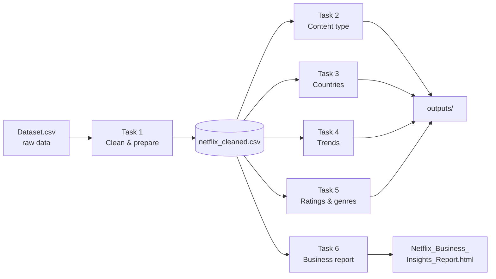

# 🎬 Netflix Content Analysis: From Raw Data to Business Insights

An end-to-end data analytics project that takes a raw Netflix catalogue file, cleans it, explores it from several angles (content type, geography, time, audience and genre) and ends with a shareable business-intelligence report.


---

## 📑 Table of Contents

1. [Project Overview](#-project-overview)
2. [Business Questions Answered](#-business-questions-answered)
3. [Dataset](#-dataset)
4. [Repository Structure](#-repository-structure)
5. [Workflow at a Glance](#-workflow-at-a-glance)
6. [Task-by-Task Breakdown](#-task-by-task-breakdown)
7. [Key Insights](#-key-insights)
8. [Techniques & Skills Demonstrated](#-techniques--skills-demonstrated)
9. [Getting Started](#-getting-started)
10. [Generated Outputs](#-generated-outputs)
11. [Limitations & Caveats](#%EF%B8%8F-limitations--caveats)
12. [Future Improvements](#-future-improvements)
13. [Author](#-author)

---

## 📌 Project Overview

Netflix's catalogue is a rich source of information about how a streaming platform positions itself: what it offers, where content comes from, who it is aimed at and how the mix has changed over time. This project turns a raw catalogue export into clear, decision-ready insights.

The work is split into **six progressive notebooks** (Easy → Medium → Advanced). Each notebook focuses on one analytical theme, and every notebook after Task 1 reads the same cleaned dataset, so the whole project is reproducible from a single raw file.

**Highlights**

- 🧹 A rigorous cleaning pipeline that finds *disguised* missing values, hidden duplicates and mixed-unit columns, with a full audit log of every change
- 📊 40+ charts, including bar/donut charts, Pareto charts, heatmaps, stacked areas, and interactive Plotly sunbursts and treemaps
- 📈 Trend metrics beyond simple counts: year-over-year change, rolling averages and CAGR
- 🧠 Insights written in a **Finding → Evidence → Recommended Action** format
- 📄 A self-contained HTML report (printable to PDF) that bundles dashboards, insights and a trend scorecard
- ✅ Every number in the written insights is **generated from the data with f-strings**, so text and charts can never drift apart

---

## ❓ Business Questions Answered

| Theme | Question |
|---|---|
| **Content mix** | How many Movies vs TV Shows are on Netflix, and how has the balance shifted? |
| **Geography** | Which countries and regions produce the most content? Which are TV-led vs movie-led? |
| **Time** | How has production grown or declined? When is content added, and how fresh is it? |
| **Audience** | Who is the content for? How is the maturity-rating mix changing? |
| **Genre** | Which genres dominate, which combine most often, and which are gaining share? |
| **Strategy** | What should a content or business team do with these findings? |

---

## 🗂 Dataset

**File:** `Dataset.csv` (Netflix titles catalogue, titles added up to **September 2021**)

| Column | Description |
|---|---|
| `show_id` | Unique ID of the title |
| `type` | `Movie` or `TV Show` |
| `title` | Title name |
| `director` | Director(s) |
| `country` | Country of production |
| `date_added` | Date the title was added to Netflix (stored as text in the raw file) |
| `release_year` | Original release year |
| `rating` | Maturity rating (e.g. TV-MA, PG-13) |
| `duration` | Mixed units: `"90 min"` for movies, `"2 Seasons"` for TV shows |
| `listed_in` | Comma-separated genre tags |

### Cleaned dataset (`netflix_cleaned.csv`), 18 columns

Task 1 keeps the original fields and adds engineered columns used by later tasks:

| New column | Purpose |
|---|---|
| `year_added`, `month_added`, `month_name` | Time-based analysis (trends, seasonality) |
| `rating_group` | Maps rating codes into 5 audience groups (see below) |
| `duration_min` | Runtime in minutes (movies only) |
| `seasons` | Number of seasons (TV shows only) |
| `n_genres` | Number of genre tags per title |
| `primary_genre` | First genre listed for the title |

**Audience groups used throughout the project**

| Group | Ratings |
|---|---|
| Kids | TV-Y, TV-G, G |
| Older Kids | TV-Y7, TV-Y7-FV, TV-PG, PG |
| Teens | PG-13, TV-14 |
| Adults | R, TV-MA, NC-17 |
| Not Rated | NR (UR merged into NR) |

> The grouping is a judgement call and is documented so it can be adjusted easily.

---

## 📁 Repository Structure

```
netflix-content-analysis/
│
├── Dataset.csv                                  # Raw input data
├── netflix_cleaned.csv                          # Created by Task 1
│
├── Task1_Data_Cleaning_Preparation.ipynb        # 🟢 Easy      – clean & prepare
├── Task2_Content_Type_Analysis.ipynb            # 🟢 Easy      – Movies vs TV Shows
├── Task3_Country_Wise_Analysis.ipynb            # 🟡 Medium    – geography
├── Task4_Trend_Analysis_Release_Year.ipynb      # 🟡 Medium    – time trends
├── Task5_Content_Rating_Genre_Analysis.ipynb    # 🔴 Advanced  – audience & genre
├── Task6_Business_Insights_Report.ipynb         # 🔴 Advanced  – capstone report
│
├── outputs/                                     # Auto-created when notebooks run
│   ├── task1_data_cleaning/                     #   cleaning_log.csv, before_vs_after_summary.csv
│   ├── task2_content_type/                      #   PNG charts + summary CSVs
│   ├── task3_country_analysis/                  #   PNG charts + country/region rankings
│   ├── task4_trend_analysis/                    #   PNG charts + yearly/decade/growth tables
│   ├── task5_rating_genre/                      #   interactive HTML charts + CSV tables
│   └── task6_business_report/                   #   dashboards, insights CSV, HTML report
│
└── README.md
```

---

## 🔄 Workflow at a Glance



> **Run Task 1 first.** Tasks 2–6 are independent of each other and each loads `netflix_cleaned.csv`. Task 6 is self-contained and does not need Tasks 2–5.

---

## 🧭 Task-by-Task Breakdown

### 🟢 Task 1: Data Cleaning & Preparation
*Notebook: `Task1_Data_Cleaning_Preparation.ipynb`*

Produces `netflix_cleaned.csv`, the foundation for everything else.

| Step | What happens |
|---|---|
| **1. Import** | Load the raw CSV into a working copy so the original is never modified; profile dtypes, non-null counts and unique values |
| **2. Missing values** | `isna()` reports zero missing values, but missing data is *disguised* as text (`"Not Given"`, etc.). A placeholder scan finds them in `director` (~29%) and `country` (~3%); both are converted to `NaN` and filled with `"Unknown"` |
| **3. Duplicates & formatting** | Whitespace is stripped; three levels of duplicates are checked (exact rows, `show_id`, and same content under a different `show_id`). **4 hidden duplicates** are removed; near-duplicates (~0.03% of rows) are **flagged but kept**. `date_added` is converted from text to datetime |
| **4. Standardisation** | `type` normalised; `country` title-cased and obsolete names merged (West Germany → Germany); `UR` merged into `NR`; `rating_group` created; `duration` split into `duration_min` / `seasons`; genres normalised with `n_genres` and `primary_genre` added |
| **5. Validate & export** | Automated `assert` checks (unique IDs, no remaining duplicates, valid types, movie/minute and TV/season consistency, sensible year range), then export of the cleaned CSV, a **cleaning log** and a **before-vs-after summary** |

**Notable decisions**
- A title literally called **"Unknown"** (the 2011 film) is *kept*. A blind find-and-replace would have corrupted valid data.
- Order of operations matters: one duplicate pair is only detected *after* whitespace is fixed.

---

### 🟢 Task 2: Content Type Analysis
*Notebook: `Task2_Content_Type_Analysis.ipynb`*

**Goal:** Understand the Movie vs TV Show distribution.

- Totals, shares and the movies-per-TV-show ratio
- Bar chart + donut chart for count and proportion
- Share of additions per year (100% stacked) and by release period (pre-1980 → 2020s)
- Target audience by content type
- Movie runtime distribution (median marked) and TV seasons distribution
- Auto-generated key findings

---

### 🟡 Task 3: Country-Wise Analysis
*Notebook: `Task3_Country_Wise_Analysis.ipynb`*

**Goal:** Discover where Netflix content comes from.

- Safe multi-country handling using the **split → explode → strip** pattern (verified rather than assumed)
- `"Unknown"` countries excluded from rankings
- A manual **country → region** mapping (North America, South America, Europe, Asia, Africa, Oceania) with an assertion that no country is unmapped
- `groupby` rankings with share % and cumulative %
- Top-15 ranking, Movies-vs-TV split per country, **TV-led vs movie-led** classification (countries with 50+ titles)
- **Pareto chart** showing how concentrated the catalogue is, plus a regional view
- Audience-mix heatmap for the top-10 countries
- Exports `country_ranking.csv` and `region_summary.csv`

---

### 🟡 Task 4: Trend Analysis by Release Year
*Notebook: `Task4_Trend_Analysis_Release_Year.ipynb`*

**Goal:** Measure how content production has changed over time.

- Yearly release counts using a full year index so years with zero titles still appear
- **Year-over-year change**, **3-year rolling average** and **CAGR** across four phases (2000→2010, 2010→2015, 2015→2018, 2018→last complete year)
- Trend line, long-view area chart, YoY bar chart and decade stack
- **Release year vs year added** comparison (industry production vs catalogue strategy)
- **Seasonality heatmap** (titles added per month) and a **freshness / lag chart** (years between release and arrival on Netflix)
- **The partial-year problem handled correctly:** the data stops in September 2021, so that year is shaded in charts and excluded from growth calculations to avoid a false "crash"

---

### 🔴 Task 5: Content Rating & Genre Analysis
*Notebook: `Task5_Content_Rating_Genre_Analysis.ipynb`*

**Goal:** Understand audience targeting through ratings and genres, using **interactive Plotly** charts.

- Rating and audience-group distributions
- Genre counts via explode (a title with 3 genres counts 3 times) and top genres *within* each content type
- **Genre co-occurrence** (most common genre pairs)
- Rating mix of Movies vs TV Shows, compared as percentages within each type
- Interactive **sunburst** (type → audience → rating), **treemap** (genre landscape), **genre × audience heatmap** and a **100% stacked area** of audience mix by release year
- An **audience segmentation table** with titles, movie share, median release year and top-3 genres per segment
- Every chart is also saved as a standalone `.html` file

---

### 🔴 Task 6: Business Insights Report (Capstone)
*Notebook: `Task6_Business_Insights_Report.ipynb`*

**Goal:** Combine everything into a decision-ready report.

| Stage | Output |
|---|---|
| **EDA** | KPIs, summary statistics, IQR-based outlier check on runtimes (outliers are real films, so they are kept and the *median* is used), 6-panel EDA figure, correlation matrix with a note that some correlations are *mechanical* by construction |
| **Trends** | **Early (2016–18) vs Recent (2019–Sep 21) scorecard** across 9 metrics, plus **genre momentum** (percentage-point change in share, genres with 150+ titles) |
| **Dashboards** | 4 themed multi-panel PNGs: Catalogue Overview, Geography, Audience & Genre, Growth & Timing |
| **Insights** | A 7-row **Finding → Evidence → Recommended Action** table |
| **Report** | `Netflix_Business_Insights_Report.html`: a single file with embedded charts, KPIs, executive summary, insight table, scorecard and limitations |

---

## 💡 Key Insights

The notebooks compute these findings directly from the data. Exact figures appear when you run them.

1. **Movies dominate the catalogue**, but TV Shows take a larger share of recent releases.
2. **Output peaked and then shifted in mix.** Release volume grew quickly through the mid-2010s; after the peak, movie releases fell while TV releases kept growing.
3. **The catalogue is geographically concentrated.** The US is the largest single source but not the majority; India is #2; Asia as a region outranks Europe; Africa and South America are under-represented.
4. **Formats differ by country.** Some markets are TV-led (e.g. South Korea, Japan, Taiwan, Pakistan) while others are movie-led (e.g. India, Indonesia, Philippines).
5. **Content skews mature.** TV-MA / TV-14 / R dominate, the Adult-rated share of new releases has risen over time, and the youngest-audience slice is small.
6. **TV skews younger than movies.** A larger share of TV titles targets Kids/Older Kids.
7. **Growth increasingly relies on older titles.** Titles added per month rose, while the share arriving within a year of release fell, a sign of back-catalogue licensing.
8. **Additions are seasonal**, with identifiable busy and quiet months.
9. **Metadata gaps** (director, country) limit deeper analysis of talent and regional performance.

> ⚠️ Explanations for *why* trends occurred (e.g. global expansion, COVID-19, a shift from quantity to quality) are presented as **hypotheses**, not conclusions. The data shows *what* happened, not *why*.

---

## 🛠 Techniques & Skills Demonstrated

| Area | Details |
|---|---|
| **Data cleaning** | Disguised-null detection, whitespace normalisation, multi-level duplicate detection, type conversion, categorical standardisation, regex-based column splitting, assertion-based validation, audit logging |
| **Data wrangling** | `groupby`, `pivot_table`, `crosstab`, `explode`, `pd.cut`, `reindex`, rolling windows, merges |
| **Analysis** | YoY change, CAGR, rolling averages, Pareto/concentration analysis, IQR outlier detection, correlation analysis, period-over-period scorecards, genre co-occurrence |
| **Visualisation** | Matplotlib, Seaborn, Plotly (sunburst, treemap, heatmap, area), multi-panel dashboards, consistent brand-colour palette |
| **Communication** | Insight framing (Finding → Evidence → Action), explicit limitations, self-contained HTML reporting |
| **Good practice** | Raw data never mutated, partial-year handling, reproducible pipeline, generated (not hand-typed) statistics |

---

## 🚀 Getting Started

### Prerequisites

- Python **3.9+**
- Packages: `pandas`, `numpy`, `matplotlib`, `seaborn`, `plotly`, `jupyter`

### Option A: Run locally

```bash
# 1. Clone the repository
git clone https://github.com/<your-username>/<your-repo-name>.git
cd <your-repo-name>

# 2. (Optional) create a virtual environment
python -m venv venv
source venv/bin/activate        # Windows: venv\Scripts\activate

# 3. Install dependencies
pip install pandas numpy matplotlib seaborn plotly jupyter

# 4. Launch Jupyter
jupyter notebook
```

Make sure `Dataset.csv` sits in the **same folder** as the notebooks, then run them **in order, starting with Task 1**.

### Option B: Run in Google Colab

1. Create a Drive folder named **`Netflix_Analysis`** (`MyDrive/Netflix_Analysis/`) and upload `Dataset.csv` to it.
2. Open a notebook in Colab and run the first cell. It mounts Drive and switches into that folder.
3. Run **Task 1** first so `netflix_cleaned.csv` is saved to Drive, then run any other task.

> No Drive? Set `USE_DRIVE = False` in the setup cell and upload files through the Colab Files panel. Note that these files are deleted when the runtime resets.

### Recommended run order

```
Task 1  →  (Tasks 2, 3, 4, 5 in any order)  →  Task 6
```

---

## 📦 Generated Outputs

| Folder | Contents |
|---|---|
| `outputs/task1_data_cleaning/` | `cleaning_log.csv`, `before_vs_after_summary.csv` |
| `outputs/task2_content_type/` | 3 PNG charts, `type_summary.csv`, `type_by_release_period.csv` |
| `outputs/task3_country_analysis/` | 4 PNG charts, `country_ranking.csv`, `region_summary.csv` |
| `outputs/task4_trend_analysis/` | 4 PNG charts, `yearly_releases.csv`, `growth_rates_by_phase.csv`, `decade_summary.csv` |
| `outputs/task5_rating_genre/` | 9 interactive `.html` charts, `audience_segments.csv`, `genre_counts.csv`, `rating_by_type_pct.csv`, `genre_audience_heatmap.csv` |
| `outputs/task6_business_report/` | EDA figure, 4 dashboard PNGs, `trend_scorecard.csv`, `genre_momentum.csv`, `business_insights.csv`, **`Netflix_Business_Insights_Report.html`** |

**Viewing the final report:** open `Netflix_Business_Insights_Report.html` in any browser. To get a PDF, use **Print → Save as PDF**.

**Viewing interactive charts on GitHub:** GitHub does not render Plotly HTML inline. Download the file and open it locally, or preview it through [htmlpreview.github.io](https://htmlpreview.github.io/).

---

## ⚠️ Limitations & Caveats

- **Snapshot, not a time series.** The data covers additions up to **September 2021**, so 2021 is a *partial year*. It is flagged in charts and excluded from growth calculations.
- **Titles, not viewership.** The dataset counts catalogue entries, not viewing hours, popularity or revenue. A five-season show counts once.
- **No Originals vs Licensed flag.** The two cannot be separated.
- **`country` = production country,** not where a title is available.
- **Genres are Netflix's own labels.** Some (e.g. *International Movies*) are catalogue categories rather than story genres.
- **Ratings describe maturity, not who actually watches** the content.
- **Recent years may look smaller than they are:** recently released titles may not have reached the catalogue yet, and licensed titles can expire.
- **Judgement calls are documented:** audience grouping, transcontinental countries (Turkey/Georgia → Asia; Russia/Cyprus → Europe), and keeping near-duplicates.

---

## 🔮 Future Improvements

- Add **viewership or engagement data** to test whether catalogue patterns reflect real demand
- Distinguish **Originals vs Licensed** content
- Build a **Streamlit or Power BI dashboard** from `netflix_cleaned.csv`
- Add **text analysis** (e.g. description keywords or topic modelling) if a description column is available
- Use **NLP / recommender techniques** for genre and similarity analysis
- Extend to a **forecasting model** for future catalogue additions
- Package the cleaning logic into a reusable **Python module with unit tests**

---

## 👤 Author

**Kunjana Ganguly**
📧 your.email@example.com
🔗 [LinkedIn](https://www.linkedin.com/in/kunjana-ganguly) · [GitHub](https://github.com/kunjana30)

---

## 📄 License

This project is released under the [MIT License](LICENSE). The Netflix catalogue data is used for educational and portfolio purposes only. Netflix and related marks are trademarks of Netflix, Inc.

---

⭐ If you found this project useful, consider giving it a star!
